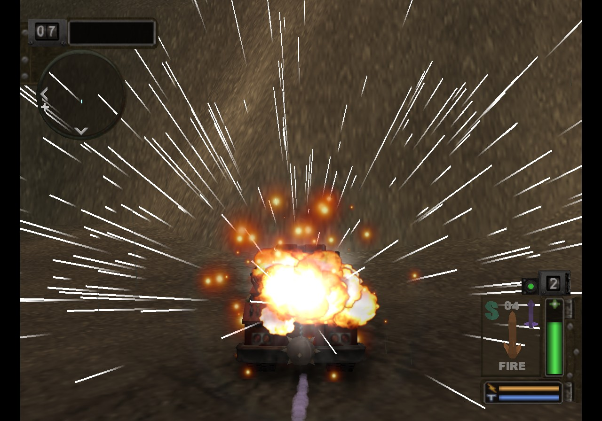
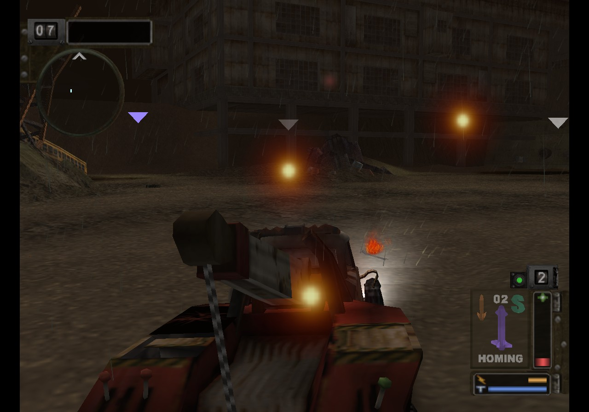
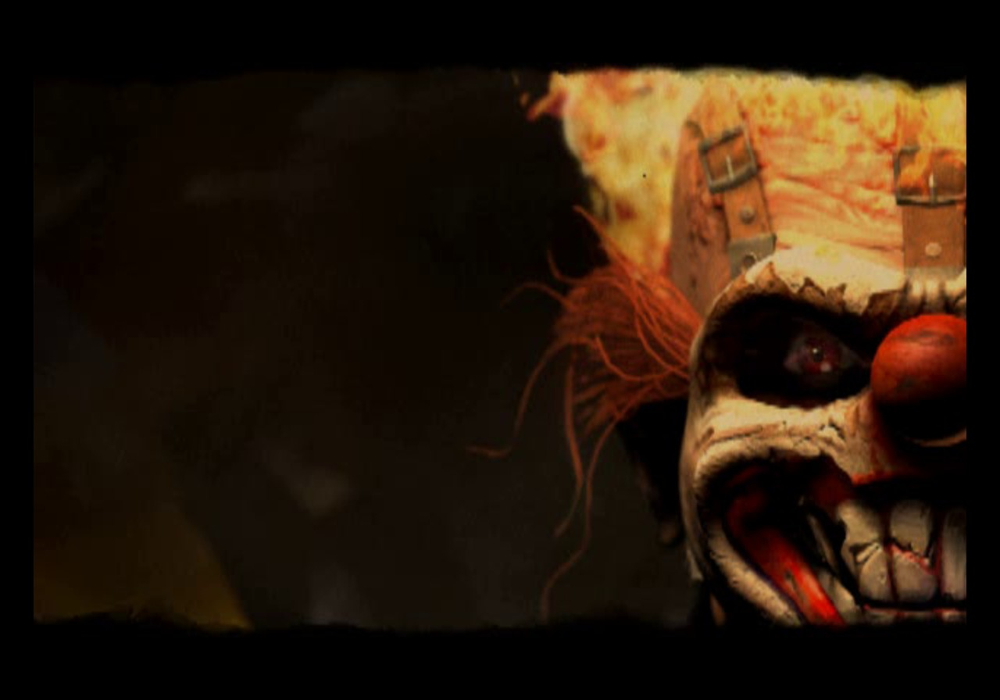
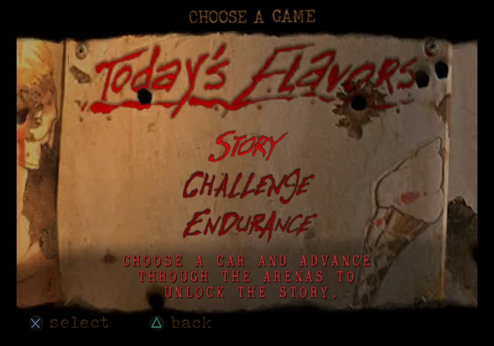

<div align="center">

# TMB_Recomp

**A native Linux and Windows port of *Twisted Metal: Black* (USA `SCUS-97101`): the whole game recompiled to C++ and run on the PC itself.**<br>
Not an emulator, and getting rid of what is left of one. The game's MIPS code (EE) and its sound driver (IOP) run as
native code; its 3D is drawn by a PC renderer from the game's own meshes, matrices and textures; its frames are paced and
its sound mixed on the PC's clock. Every VU1 program the game runs is native C++ (no VU1 interpreter, no sandbox).
No GS front end either: by default no GS object, no GS memory, no GS thread and no GS register state exist; the native
renderer draws and presents every frame, and what the game still asks of the display (the field a vblank ended, its
display mode) comes from native code on the PC's clock.


</div>

> [!IMPORTANT]
> No game files are included: no ELF, IRX modules, data archives, or code generated from them.
> You need **your own copy** of the game: the USA release, PS2 ID **`SCUS-97101`**. The port is built against its
> executable:
>
> | File | SHA-1 |
> |---|---|
> | `SCUS_971.01` | `3ff17f4897552e355d0bb8c3abfa5125fe3ff2ef` |

## Status

Picking the work up elsewhere: [`docs/HANDOFF.md`](docs/HANDOFF.md) (state, how to measure, next steps).

**Playable, at full speed, as a native port, at NTSC's 60 frames per second.** The game boots, runs its own IOP modules,
plays the movies with their sound, goes through the menus and level loading, and plays matches
and story levels: driving, weapons, bots, HUD, music and effects, deaths, respawns, saving and loading. With the native
path (`scripts/run_native.sh`, at twice the PS2's resolution) a match holds 57.7 to 60.4 fps (4 players split screen:
55.8 to 60.4) on a Ryzen 7 7800X3D with an RTX 5070 Ti. Still being checked: every arena and story level to the endings, and some effects against the PS2 picture
(issues found while playing are fixed as they come: [docs/RECOMP_NOTES.md](docs/RECOMP_NOTES.md)).

<p align="center">
  
  
  
  
</p>
<p align="center"><sub>The USA release on the native path (<code>scripts/run_native.sh</code>), drawn at twice the PS2's resolution.</sub>
</p>

| Milestone | |
|---|:---:|
| Map and recompile the main ELF (3,572 functions, symbols intact) | ✅ |
| Link the generated code with the PS2Recomp runtime on Linux and Windows | ✅ |
| Boot: EE kernel, the game's own IOP modules, CD reads from the disc files | ✅ |
| USA release (SCUS-97101, NTSC 60 Hz) | ✅ |
| Controller input; every button and stick direction rebindable to keys, controllers and the mouse (F2, `input.ini`) | ✅ |
| Movies (PSS, MPEG-2 decoded with FFmpeg) | ✅ |
| Title screen and main menu | ✅ |
| Memory card: save, load, overwrite (`mc0`, `mc1` in the disc folder) | ✅ |
| Story mode: level 1 of 8 cleared (Junkyard, Midtown Suburbs), progress saved and loaded | ✅ |
| Menus, level select, level loading | ✅ |
| First match: HUD, cars, textured 3D, bots | ✅ |
| Deaths, respawns, game over and replay | ✅ |
| Full speed (60 fps): native renderer, VU1 microcode as native code | ✅ |
| Frames paced on the PC's clock, not on the PS2's vblanks | ✅ |
| Sound and music (989SND, movie audio) | ✅ |
| Every IOP module recompiled (sound driver, pad, memory card...), sound mixed on the PC's clock (not tied to the frame rate) | ✅ |
| The match's 3D drawn from the game's own data (translated VU1 programs) | ✅ |
| Every VU1 program translated (menus, 3D, beams, chrome and water, particles, flares, trails, heat haze, lightning): no VU1 sandbox | ✅ |
| No GS emulation: no GS front end, no GS memory, no GS packet read; the native renderer draws and presents the frame (`runtime/native/native_display.h` for the display's field and mode) | ✅ |
| Multi-player split screen, 2 to 4 players (a multitap on port 0: players 1-4 on their own controllers; `PS2X_PAD2_SCRIPT` to `PS2X_PAD4_SCRIPT` for scripted players) | ✅ |
| Every Challenge arena played (all of them; the ones a fresh save keeps locked through the Cheats tab's Unlock everything) | ✅ |
| Settings window (F2): controls, video (resolution, windowed / fullscreen / borderless, render scale) and cheats, all switched while playing | ✅ |
| Every story level to the endings (level 1 of 8 checked) | 🔧 |
| Higher internal resolution (2x by default; the Video tab's render scale, `PS2X_RENDER_SCALE`) | ✅ |
| Widescreen, frame rates above the PS2's | ⏳ |

**Native port** (no PS2 hardware emulation left, not even a small part: the shared goal of the fork's ports). Native
means the game's draws built straight from its own data (vertices, matrices, materials), with no GIF packet, no GS
state machine and no copy of GS memory in between.

| Layer | |
|---|:---:|
| IOP modules (989SND, LIBSD, PADMAN, SIO2MAN, MTAPMAN, MCMAN, MCSERV, USBD, LGDEV) recompiled to C++, none interpreted (0 interpreted instructions after boot in `[iop:hw]`) | ✅ |
| No IOP hardware: no SIO2, no IOP interrupt controller, DMA or timer registers modelled; the modules reach the IOP through their imports only (`[iop:hw] hardware absent`) | ✅ |
| Sound and IOP on the PC's clock (`PS2X_SPU2_WALLCLOCK=1`, `PS2X_IOP_WALLCLOCK=1`) | ✅ |
| No SPU2 emulation: 989SND's libsd calls played by the fork's native mixer (`PS2X_NATIVE_AUDIO=1`), the SPU2 absent | ✅ |
| No paraLLEl-GS: OpenGL on the GPU (the GS native back end) | ✅ |
| Frame loop on the PC's clock (`FramePacer`; `TMB_NATIVE_FRAMES=0`: the vblanks) | ✅ |
| Every VU1 program translated to C++ (3D, skinning, effects), no VU interpreter and no sandbox | ✅ |
| Every VU0 program translated to C++ (the scene traversal's, bit-exact with VU0, and the 2D engine's), no VIF0 packet read, no VU0 interpreter (`runtime/tmb_vu0.cpp`) | ✅ |
| Textures from an offline native pack, looked up by the game's own texture ids | ✅ |
| Font, HUD, loading bar, overlays' darkening and movies drawn natively from the game's variables (no GIF packet built or read) | ✅ |
| 3D meshes from an offline native pack (`tools/tmb_mesh_pack.py`, through the fork's generic pack writer and runtime: `PS2Recomp/docs/native_packs.md`) drawn at the game's per-object hook from its own state, in the game's own order, clipped to its microprograms' clip volume; no VIF stream read | ✅ |
| Effects (particles, lens flares, rain...) drawn from the game's particle lists (`runtime/tmb_particles.cpp`); no VIF stream read | ✅ |
| IOP kernel layer (interrupts, timers, SIF) under the recompiled IOP modules: still the fork's model | 🔧 |
| No GS front end, no copy of GS memory, no VIF stream read: the native renderer draws and presents the whole frame (`TMB_GS_FRONTEND=1` and the diagnostic switches bring the GS front end back, headless) | ✅ |

✅ works · 🔧 in progress · ⏳ not reached yet

[docs/RECOMP_NOTES.md](docs/RECOMP_NOTES.md) records how the port is brought up, every fix and how it was found, and
what remains open.

## Goal

A fully playable *Twisted Metal: Black* as a true PC program, from the intro to the endings: no PS2 hardware simulated
where the PC can do the job itself. Accuracy first; then widescreen and frame rates above the PS2's.

## How it works

The port started as a static recompilation on a reimplementation of the PS2 hardware, and is becoming a native PC
program piece by piece. Each piece below replaces a part of the PS2 that was simulated:

| Part of the game | On the PS2 | In the port |
|---|---|---|
| Frame timing | the vblank interrupt; the game counts the fields a frame took from a hardware timer | each frame paced on the PC's clock (the fork's `FramePacer`) and shown as soon as it ends, its fields counted from the real time it took (`TMB_NATIVE_FRAMES=0`: the vblanks) |
| Game code (EE, MIPS R5900) | the EE CPU | 3,572 functions recompiled to C++ (`generated/`), with the ELF's own symbols |
| IOP modules (989SND, LIBSD, PADMAN, SIO2MAN, MTAPMAN, MCMAN, MCSERV, USBD, LGDEV) | R3000A code on the IOP | all recompiled to C++ by the fork's `tools/iop_recomp.py` (`scripts/iop_recomp.sh`), switch cases and frameless leaf functions included; none left interpreted (`[iop:hw]`: interpreted instructions 0) |
| IOP hardware (interrupt controller, DMA channels, root counters, SIO2, CDVD and SIF registers) | devices behind the IOP's registers | none: the IOP kernel (threads, semaphores, events, intrman, timrman, vblank), SIF (sifman, sifcmd, RPC) and cdvdman are answered natively at their API; pad and memory card are the EE's libpad / libmc HLE; the registers a module's start code still touches (LIBSD's bus setup, USBD's probe, SIO2MAN's first write: about 1000 accesses at boot, none after) are plain storage without effect (`PS2X_IOP_HARDWARE=0`, TMB's default; `TMB_IOP_HARDWARE=1` brings the models back) |
| Sound mixing (SPU2) | the SPU2 chip, at the IOP's pace | no SPU2: libsd's exports (the recompiled 989SND's calls: voices, banks, effects, the movie stream) taken over by the fork's native mixer (`ps2xIOP/src/native_audio`, `PS2X_NATIVE_AUDIO=1`, TMB's default): 48 voices playing the game's ADPCM banks from a native sound memory, ADSR, reverb and the looping sound data input (movie audio), mixed at 48 kHz when the PC's audio device asks; the SPU2 emulation is absent (no sound RAM, no registers, no DMA, never scheduled; `TMB_NATIVE_AUDIO=0` brings it back) |
| 3D (hier renderer: terrain, buildings, cars, characters) | VU1 microprograms, then the GS | every object kind (rigid, pool-less, sprites, ribbons, skinned, environment-mapped and morphing objects) drawn from a native mesh pack the NGP files' prebuilt packets are converted into offline (`tools/tmb_mesh_pack.py`, which only parses the NGP files and writes through the fork's `tools/native_pack`; the pack's loader, object store, view order, GS state and clipping are the fork's `runtime/native/native_mesh_pack.h` / `native_mesh_draw.h`, shared with the other ports), at the game's per-object hook (`pktAddVu1ObjAsm`) from its own state (`runtime/tmb_meshes.cpp`), submitted in the game's own order (opaque in traversal order, alpha by `pktLinkAlphaObjAsm`'s depth buckets) at each view's kick, each triangle clipped to the strip programs' own clip volume (VU 13-16 x VU 0-3, as their CLIP test does); no VIF stream is read and VU1 runs nothing (`TMB_NATIVE_VIF=1`: the old stream reading, for comparison) |
| Skinned characters, sprites, rain, fog, blending | VU1, GS | translated into the native renderer's terms (bones, fog factor, blend modes) |
| Effects (particles, lens flares, streaks, trails, heat haze, lightning, beams, chrome and water) | VU1 | drawn from the game's own particle lists and flare list (`runtime/tmb_particles.cpp`), the effects programs' work done natively; the per-program translations of the stream (`runtime/tmb_native.cpp`, checked against VU1's own output with `TMB_NATIVE_CHECK`) remain for the comparison modes |
| Textures | GS memory | converted once, offline, from the disc's `.TEX` / `.RTX` files into a native pack in the build tree (`tools/tmb_texture_pack.py`, run by `scripts/recomp.sh`; the pack format, loader and PS2 texel decoders are the fork's `native_texture_pack.h`); at runtime looked up by the game's own keys, caught in its texture code (each texture's id as `texmSetupTexture` sets it up, each palette's VRAM block as `texmLoadResTexture` loads it): nothing read from texture records, GS packets or GS memory while the game runs (`runtime/tmb_textures.cpp`) |
| Font, HUD, loading bar, overlays, movies | GS, IPU | drawn natively from the game's variables: each packet builder rewritten in C++ (`runtime/tmb_2d.cpp`), nothing built or read as a GS packet; movies decoded with FFmpeg and shown as the native renderer's backdrop |
| Everything else sent to the GS | GS | nothing: no GS front end is constructed (`ps2x::native::setGsFrontEndAbsent`), no GS memory allocated; the DMA kicks to the GIF, VIF1 and VIF0 complete unread, the libgraph calls send nothing, the game's display registers writes are dropped and its reads of CSR get the field from the native display (`runtime/native/native_display.h`: vblanks on the frame pacer's clock); the native renderer presents its own frame (circuit-2 picture, movie backdrop, 3D, 2D) |
| Display (vblank, CSR.FIELD, display mode) | GS CRTC | native: the field from the EE scheduler's vblank count, the mode from `sceGsResetGraph` / `SetGsCrt`, `GsPutIMR` kept for `GsGetIMR` (no GS interrupt exists) |

```
disc files (game_us/, game/) ──► ps2_analyzer ──► recomp/tmb_scus97101.toml, tmb_sces50360.toml (+ recomp/tmb_manual.toml)
                                           │
                     ps2_recomp + the ELF's own symbol table ──► C++ (one file per function, generated/)
   989SND, LIBSD as the IOP loads them ──► iop_recomp.py ──► C++ (generated/iop/)
                                           │
                 CMakeLists.txt ──► PS2Recomp runtime + generated code + runtime/ (TMB's overrides, native adapter)
                                           │
   native renderer · texture cache · native sound mixer on the PC clock ──────┼─► ps2EntryRunner
   native display (field, mode) · window presentation on the GPU, at 2x (no GS front end; diagnostics: the GS native back end)
   what is left of the PS2: EE kernel HLE · DMAC (kicks to the GIF / VIF complete unread) · IPU · IOP kernel layer
```

- **The USA executable's addresses.** The build is `game_us/` -> `generated_us/` -> `build/game_us`; `runtime/`'s hooks
  use the USA executable's addresses and its generated function names directly, and `recomp/tmb_manual.toml` holds the
  recompiler's hand-written settings by symbol name. NTSC draws a 640 x 224 field, which the native renderer follows.
- The executable ships its full symbol table (3,572 named functions, `.mdebug`), so no Ghidra pass is needed:
  `ps2_analyzer` reads the symbols, recognises the Sony SDK functions that have runtime handlers and writes the config.
- PS2Recomp turns every function into C++ and emits the address-indexed function table.
- `runtime/tmb_meshes.cpp` (3D at the game's hooks), `runtime/tmb_particles.cpp` (effects from the particle lists),
  `runtime/tmb_2d.cpp` (2D builders), `runtime/tmb_textures.cpp`, `runtime/tmb_vu0.cpp` draw the game natively;
  `runtime/tmb_native.cpp` sets the native switches, publishes the frame, and keeps the old VIF1-stream adapter for the
  comparison modes (`TMB_NATIVE_VIF=1`). The generic parts live in the fork (`ps2xRuntime/src/lib/native/`: renderer,
  texture cache, GIF translation; `docs/native.md`), shared with the other ports.
- `runtime/tmb_overrides.cpp` holds the other game-specific bindings.

The PS2Recomp fork lives in `PS2Recomp/` (git submodule, [boubou666/PS2Recomp](https://github.com/boubou666/PS2Recomp)),
shared with the other recompilations built on it (*Valkyrie Profile 2*, *Drakengard*, *The Lord of the Rings: The Third
Age*, *Jade Cocoon 2*, *Soulcalibur III* and others). Fixes made for this port land there.

## Requirements

- Linux (developed on Arch) or Windows 10/11 with [MSYS2](https://www.msys2.org/) (UCRT64, see below)
- CMake 3.21+, Ninja, GCC 13+ or Clang with C++20
- FFmpeg development libraries (`libavcodec`, `libavutil`, `libswscale`) and `pkg-config` (or a static FFmpeg folder: `PS2X_FFMPEG_ROOT`)
- X11/Wayland and OpenGL development headers (raylib is fetched and built by the fork)
- `bsdtar` (libarchive) to extract the disc
- A CPU with AVX2 (the runtime is built for `x86-64-v3`)
- Your own copy of `SCUS-97101` (check the hash above)

## Build and run

### One command, from your disc (Windows)

`tools/tmb_build.py` goes from your own disc image to a game folder that runs, with nothing derived from the game
ever downloaded: it checks the disc (the USA release, SCUS-97101: `SCUS_971.01`'s SHA-1; the European disc and other
images are refused with a message saying so), extracts it with its own ISO9660 reader (`.iso`, `.bin` / `.cue`; no
bsdtar), recompiles the game's code and VU1 microcode, converts the textures and models into their packs, recompiles
the IOP modules straight from the disc's `MOD/*.IRX` (no boot of the game), compiles the runner and stages it.

```bat
python tools\tmb_build.py --disc "D:\Games\Twisted Metal - Black (USA).iso" --out D:\TMB
"D:\TMB\TMB\Play TMB.cmd"
```

- Python: the standard library only, so the Windows embeddable Python (`python-3.x-embed-amd64.zip`) runs it; every
  build-time tool it calls is stdlib-only too.
- Compiler: `--toolchain <dir>` (a folder whose `bin` has `g++`, `gcc`, `cmake`, `ninja` and `pkg-config`), else the
  PATH, else `C:\msys64\ucrt64` (MSYS2 UCRT64 with the packages below). No bash, MSYS2 shell, bsdtar or rsync.
- `--tools <dir>`: prebuilt `ps2_recomp` / `ps2_vu_aot` (otherwise built from `PS2Recomp`). `--fetch-cache <dir>`:
  the libraries CMake fetches (`raylib-src`, `imgui-src`, ... as CMake left them) instead of downloading them with git.
- `--disc` also takes an extracted disc folder; its `.iso` is still needed (in it or a folder above), as the game reads
  raw sectors from the image.
- The game ends up in `<out>/TMB`: `ps2EntryRunner.exe`, the DLLs it loads, the two packs, `disc/` (the disc's files),
  `disc.iso` (a hard link to your image on the same drive, else a copy) and `Play TMB.cmd`.
- Resumable: a step finished with the same inputs is skipped (`--redo <step>` runs it and the ones after again,
  `--stop-after <step>` stops there). For a launcher, stdout has one line per event: `PROGRESS <step> <i>/<n>
  <message>`, `PERCENT <step> <0-100>`, `SKIP <step> <i>/<n>`, `DONE <step> <i>/<n> <seconds>`, `ERROR <step>
  <message>` (exit code 1), `RESULT <game folder> <launcher>`; each step's full output is in `<out>/logs/`.
- From an empty folder on a Ryzen 7 7800X3D: about 9 minutes (the compile 5, the recompiler's build and CMake's
  downloads 1.5 each).

### The build kit: nothing installed (Windows)

`tools/make_build_kit.py` assembles, once on a developer's PC (MSYS2 UCRT64 installed, network), the folder that lets
`tmb_build.py` run on a PC with nothing installed: no MSYS2, no git, no network, no Python.

```bat
python tools\make_build_kit.py --out D:\tmb_kit\kit --zip D:\tmb_kit\tmb_build_kit.zip
rem on the player's PC: TMB_Recomp\ (this repository's files) and kit\ side by side
kit\python\python.exe -I TMB_Recomp\tools\tmb_build.py --disc "D:\Games\Twisted Metal - Black (USA).iso" --out D:\TMB
```

| Kit folder | Contents |
|---|---|
| `ucrt64/` | MSYS2 UCRT64's GCC 16.2, binutils, mingw-w64 headers and CRT, winpthreads, CMake 4.4, Ninja 1.13: the packages' files minus documentation, translations, GCC plugin headers, `lto1`, gcov, the prefixed duplicates, binutils' libraries, old / Store / API-set import libraries; plus the DLLs those programs load (CMake's curl, OpenSSL...) |
| `ffmpeg/` | FFmpeg 9.0.2 (ffmpeg.org tarball, SHA-256 and release signature checked), LGPL, static: `--disable-everything` plus the `mpeg2video` decoder and `mpegvideo` parser; avcodec, swscale, avutil only (5 MB), built with the kit's GCC |
| `deps/` | the FetchContent sources at the pinned tags (raylib, imgui, rlImGui, ELFIO, toml11, fmt, libdwarf, rabbitizer), without `.git` |
| `tools/` | `ps2_recomp.exe`, `ps2_vu_aot.exe` built with the kit, static |
| `python/` | the Windows embeddable Python 3.14 (python.org, SHA-256 pinned) |
| `sources/`, `licenses/`, `kit_manifest.json` | FFmpeg's source tarball; each component's license files; versions, origins, hashes, licenses, sizes |

- `tmb_build.py` uses the kit when it sits in `TMB_Recomp\kit` or next to the `TMB_Recomp` folder (or `--kit <dir>`;
  `--no-kit` ignores it): the kit's compiler, recompilers and sources, FFmpeg through `PS2X_FFMPEG_ROOT` (no
  pkg-config) and `PS2X_ENABLE_PARALLEL_GS=OFF` (paraLLEl-GS, a GS-emulation diagnostic the native port does not use).
  The game folder then holds the runner and three DLLs (libstdc++, libgcc, winpthread) instead of 81.
- Size: 468 MB unpacked, 142 MB as a zip; assembled in about 2.5 minutes. From an empty folder with the kit and a
  PATH of only the Windows folders: 4 minutes to the game folder (compile 3.4), no recompiler build, no downloads.
- The kit is build output, never committed. GCC, binutils and the other MSYS2 binaries are redistributed unmodified:
  a public kit must also ship or offer their sources (MSYS2's source packages of the versions in the manifest).

### Step by step (development)

```bash
git clone --recurse-submodules https://github.com/boubou666/TMB_Recomp.git
cd TMB_Recomp
scripts/extract_iso.sh "/path/to/Twisted Metal - Black (USA).iso"      # disc files -> game_us/
scripts/build_tools.sh                                                  # ps2_recomp, ps2_analyzer, ps2_vu_aot -> build/tools
scripts/recomp.sh                                                       # ELF + recomp/tmb_scus97101.toml -> generated_us/ (VU1 microcode -> generated_us/vu1/)
scripts/build_runtime.sh                                                # runtime + generated code -> build/game_us
scripts/iop_recomp.sh                                                   # the IOP modules from game_us/MOD, loaded offline -> generated_us/iop/ (then rebuild)
scripts/run_native.sh                                                   # the native port (native renderer, recompiled sound driver, sound on the PC clock), with the fps counter
scripts/run.sh                                                          # the PS2 path only (VU1 and GS simulated, TMB_NATIVE=0), for comparison
scripts/pgo.sh                                                          # optional, experimental: profile-guided rebuild (~200 s of scripted play)
```

### Windows

The same scripts run in an MSYS2 **UCRT64** shell, with MSYS2's GCC (MSVC is not supported for this port).

```bash
pacman -S --needed mingw-w64-ucrt-x86_64-{gcc,cmake,ninja,pkgconf,ffmpeg,python} git rsync
git clone --recurse-submodules https://github.com/boubou666/TMB_Recomp.git
```

Then follow the steps above. `scripts/stage_dlls.sh` copies the DLLs the runner needs next to
`ps2EntryRunner.exe`, so it can also be started outside the MSYS2 shell. The native port draws with OpenGL 3.3; the
PS2 path (`scripts/run.sh`) draws the GS with paraLLEl-GS, which needs a Vulkan driver (any recent NVIDIA, AMD or Intel
driver ships one).

`scripts/regress.sh <build-dir> <out-dir>` is the fork's port regression run for TMB: boot movies, menus and a
Skyscrapers match under the bench lock, with a `summary.txt` (route reached, exit, fps mean and p10, frames over 25 ms,
errors) and the last frame.

`scripts/analyze.sh` regenerates the TOML from scratch; it discards manual edits, so diff before committing.
The runner build compiles about 70 MB of generated C++ and takes a while the first time.

Run the game with the extracted disc folder as `cdrom0:` (that is what `scripts/run_native.sh` does):

```bash
build/game_us/PS2Recomp/ps2xRuntime/ps2EntryRunner game_us/SCUS_971.01
```

### As a PC game (no scripts, no variables)

The runner started with nothing set (a double-click on `ps2EntryRunner.exe`) is the full native port, the same game as
`scripts/run_native.sh`: everything that script sets (`TMB_NATIVE=1`, the native renderer, the recompiled sound driver,
the sound and the IOP on the PC's clock) is the runner's default, and the variables below still change it
(`TMB_NATIVE=0`: the PS2 path). The frame rate counter is off (F3 shows it, `PS2X_SHOW_FPS=1` starts with it, as
`scripts/run_native.sh` does).

- **Game data.** With no argument the runner looks for `game/SCUS_971.01` next to it, then in the user folder; `game/`
  holds the disc's files and the disc image (`.iso`, for the raw sector reads: the sound banks). With neither, a message
  box says the data was not found (run the launcher, or see this README) and where it looked.
- **Window.** Titled *Twisted Metal: Black*, with an icon (a placeholder, `runtime/app/tmb.ico`; no game art). No
  console window on Windows: the runner is a GUI-subsystem program. Started from a terminal (MSYS2, cmd, PowerShell) or
  with its output redirected, it prints there as before.
- **User folder.** `%APPDATA%\TMB_Recomp` on Windows, `$XDG_DATA_HOME/tmb_recomp` (`~/.local/share/tmb_recomp`) on
  Linux, created on the first run (`PS2X_USER_DIR=<dir>` for another one):

  | What | Where in the user folder |
  |---|---|
  | Memory cards | `mc0/`, `mc1/` |
  | Settings (F2) | `input.ini`, `video.ini` (`PS2X_INPUT_CONFIG`, `PS2X_VIDEO_CONFIG` still name other files), `imgui.ini` |
  | Log | `logs/TMB_Recomp.log`, the two runs before as `TMB_Recomp.1.log`, `TMB_Recomp.2.log`: everything the runner prints (`PS2X_LOG_FILE=<file>` another file, `=0` none) |
  | Crash reports | `crashes/crash-<date>-<time>.txt` |

  The first run copies the cards and settings kept next to the ELF until now (`game_us/mc0`, `mc1`, `input.ini`,
  `video.ini`) into it, once per old folder (`migrated.txt` lists them): a save already on the new card is not
  overwritten, nothing is deleted.
- **Crashes (Windows).** A crash writes a report (the exception, its address and module, the stack as module+offset
  with the address `addr2line -f -C -e ps2EntryRunner.exe` takes, the last 200 log lines) and a message box points at
  it and at the log: what a player attaches to a bug report. `PS2X_TEST_CRASH=<s>` crashes on purpose after s seconds
  to try it; `PS2X_NO_DIALOGS=1` keeps message boxes out of unattended runs (the log has their text).

Player 1 plays with the keyboard and the first controller, player 2 with the second controller. The default keys (US
key positions):

| PS2 button | Keyboard |
|---|---|
| D-pad | Arrow keys or W A S D |
| Cross / Circle / Square / Triangle | X or Space / C or Esc / Z or Numpad 0 / V or Numpad 1 |
| L1 / R1 / L2 / R2 | Q / E / Left Shift / Right Shift |
| Start / Select | Enter / Tab |
| L3 / R3 | F / G |
| Left stick / right stick | the movement keys (with the D-pad) / I J K L |

| Key | What it does |
|---|---|
| F1 | Runtime debugger |
| F2 | Settings. Controls: rebind every PS2 button and stick direction, per player, to keys, controller buttons, sticks and triggers, mouse buttons, the wheel or mouse movement (sensitivity, invert Y, cursor capture). Saved to `input.ini` in the user folder (`%APPDATA%\TMB_Recomp\input.ini`; `PS2X_INPUT_CONFIG=<file>` for another place). Video: the resolution (common 4:3 and 16:9 sizes up to the monitor's, and the monitor's own), windowed, fullscreen (the monitor switched to that resolution) or borderless window (the monitor's size), and the render scale (the 3D at 50 % to 200 % of the window's resolution; 200 % is supersampled); Apply changes them at once, Apply and save writes `video.ini` next to `input.ini` (`PS2X_VIDEO_CONFIG=<file>` for another place), read when the window opens. The picture stays 4:3, centred with bars, whatever the window's shape. |
| F11, Alt+Enter | Between the window and full screen (the last full-screen mode chosen, borderless by default) |

### Cheats

The Cheats tab of the settings window (F2) switches them while playing, each at once, in a match (one player or split
screen); the variables give their state at launch (`runtime/tmb_cheats.cpp`).

| Cheat | | Variable |
|---|---|---|
| Unlock everything | every level (Freeway, Prison Passage, Skyscrapers, Minion's Stadium...), every vehicle (Yellow Jacket, Axel, Warthog, Manslaughter, Minion...) and every movie, opened in the menus; switched off, put back; saving while it is on keeps them on the card | `TMB_UNLOCK_ALL=1` |
| Infinite health | per player: the car's health held at its maximum (the game's own, as its health bar shows it) | `TMB_PLAYER_GOD=<players>` |
| Infinite ammo | per player: pickup weapons and the special are not spent (the HUD's counts stay) | `TMB_INFINITE_AMMO=<players>` |
| Infinite energy | per player: the energy bar (freeze, mines, shield...) held full | `TMB_INFINITE_ENERGY=<players>` |
| No AI | the computer's cars do nothing | `TMB_NO_AI=1` |
| Weak enemies | the computer's cars held at most this much health (a slider, 1 to 300) | `TMB_ENEMY_HEALTH_CAP=<x>` |

`<players>`: digits 1 to 4 (`12`: players 1 and 2), any other value but `0` every player.

<details>
<summary><b>Runtime and diagnostic options</b></summary>

| Variable | Effect |
|---|---|
| `TMB_NATIVE=0` | Not the native port (the default, `TMB_NATIVE=1`: the native renderer at 2x, no GS front end, the recompiled IOP modules, the native sound mixer, the IOP on the PC's clock; each part has its own switch below): the PS2 path, as `scripts/run.sh` runs it |
| `TMB_GS_FRONTEND=1` | The GS front end exists again (constructed, its GS memory, its thread, the GS native back end), headless: it receives nothing and draws nothing, as before the GS front end was removed; `[tmb:gs]` (with `TMB_TRACE_PACKETS=1`) then lists what reaches it. By default (`ps2x::native::setGsFrontEndAbsent`, decided before the runtime starts) there is no GS object, no GS memory, no GS thread and no raster backend; the guest's CSR reads get FIELD from the native display, its writes to the display registers are dropped, the libgraph calls reach no GS. Every switch below that needs the GS front end (`TMB_GS_HEADLESS=0`, `TMB_GS_PACKETS=1`, `TMB_NATIVE_VIF=1`, `TMB_NATIVE_FRAME=0`, `TMB_NATIVE_VU1=1`, `TMB_VIF0_PACKETS=1`, `TMB_VU0_NATIVE=0`, `PS2X_VU0_HLE_CHECK=1`, a `PS2X_GS_RENDERER` other than native) brings it back too |
| `TMB_GS_HEADLESS=0` | The GS front end back (as `TMB_GS_FRONTEND=1`), drawing its (unseen) frame from the game's packets; by default there is no GS front end |
| `TMB_GS_PACKETS=1` | The fork reads the game's VIF1 and GIF DMA chains again (its VIF1 interpreter, the GIF tags, the headless GS front end looking for SIGNAL / FINISH / LABEL), for an A/B. By default a DMA kick to VIF1 or the GIF completes unread (`ps2x::native::setGsDmaSkipped`): no DMA tag, VIFcode or GIF tag is read, the libgraph image transfers and drawing environment send nothing, and the channel's end (STR, D_STAT, its DMAC handlers) comes at the kick |
| `TMB_TRACE_PACKETS=1` | Every 250 frames, `[tmb:gs]`: what reached the GS front end, GS memory or the GS registers (none by default), what the native display answered instead (the guest's CSR reads, its dropped display register writes, the vblanks, the frames ended) and the libgraph calls the game made; `[tmb:packets]`: what the fork read of the GS, VIF1 and VIF0 packets (GIF packets, SIGNAL / FINISH / LABEL, VIF1 and VIF0 interpreter runs, DMA chains walked), the VU0 microprograms run on VU0's interpreter (or not run: no native version) and the DMA kicks per channel; `[tmb:vu0]` the VIF0 kicks by chain (2D, hierarchy, ROW / MASK, other) and the programs not run natively, by image and pc; logged without it whenever something was read or interpreted |
| `TMB_VIF0_PACKETS=1` | The fork reads the game's VIF0 DMA chains again (its VIF0 interpreter: the MPGs filling VU0's code memory, the 2D chain's UNPACKs), for an A/B; VU0's code memory then says which image the programs belong to, checked against the image the kicks noted. By default a DMA kick to VIF0 completes unread (`ps2x::native::setVif0Skipped`): the image is the one whose chain the game's TADR names (hier__Fi and main kick the hierarchy chain, drawInit the 2D one) and the 2D chain's data is copied into VU0 from the game's EE memory at the kick (`runtime/tmb_vu0.cpp`) |
| `TMB_VU0_NATIVE=0` | The VU0 microprograms on VU0's interpreter instead of their C++ versions (`runtime/tmb_vu0.cpp`); VIF0 is read then (the interpreter needs the code) |
| `PS2X_VU0_HLE_CHECK=1` | Each VU0 program run natively runs on the interpreter too, from the same state, and `[vu0:hle]` reports per pc the calls, those differing and those not bit-exact (registers and VU0 data memory); VIF0 is read then (the interpreter needs the code) |
| `TMB_NATIVE_VIF=1` | Reads the VIF1 stream again (the old adapter) to place the hier objects at their marks; with `TMB_NATIVE_MESHES_CHECK=1` the objects stay in the game's order from its hooks and `[tmb:order]` compares the two. By default nothing reads the VIF1 stream and VU1 runs no program |
| `TMB_NATIVE_FRAME=0` | The GS front end back: the native draws go into its frame, which presents it, instead of the native renderer presenting its own frame |
| `TMB_NATIVE_MESHES=0` | The rigid 3D objects back on the VIF stream's translation instead of the mesh pack (`TMB_NATIVE_MESHES_CHECK=1`: compare the two) |
| `TMB_NATIVE_PARTICLES=0` | The particles back on the game's own packets (`TMB_NATIVE_PARTICLE_TYPES=1,2,3`: which types are native; `TMB_NATIVE_PARTICLES_TOGGLE=<s>`: alternate, for an A/B) |
| `TMB_NATIVE_FRAMES=0` | Frames on the emulated vblanks instead of the PC clock |
| `PS2X_GS_SCALE=<n>` | With `TMB_NATIVE=1`: the internal resolution, n times the PS2's each way (1 to 4, default 2) |
| `PS2X_WINDOW_SIZE=<w>x<h>`, `PS2X_WINDOW_MODE=windowed\|fullscreen\|borderless`, `PS2X_RENDER_SCALE=<x>` | The window's size, mode and render scale when it opens, over `video.ini` (F2, Video) |
| `TMB_NATIVE_VU1=1` | VU1 runs the translated programs too (the GS frame then has everything, to compare) |
| `TMB_NATIVE_VU1_PCS=<pc,...>` | Diagnostic: leave those setups on VU1 (a `PS2X_VU1_RECORD` reference for a translation) |
| `TMB_NATIVE_CHECK=<n>` | Diagnostic: run VU1's own program beside each translation (an interpreter, off in play) and log where they differ |
| `PS2X_PRESENT_STATS=1` | Every 600 presents: the game frames not shown and the waits that timed out (the window shows each frame the game publishes once, on the game's clock: no periodic stutter) |
| `TMB_LIVE_TOGGLES=<file>` | Diagnostic: words read from the file every 60 frames while the game runs, for the 3D at the hooks: `nodepth`, `nofog`, `noclip`, `flat` (each object in a colour of its own), `opaque`, `noatest`, `notex`, `noguard` (no clip volume), `dump` (one frame's objects, materials and triangles to the log) |
| F9 (with `PS2X_CAPTURE_WINDOW_DIR`) | Start / stop a burst of window captures, ten a second (`burst_<ms>.png`) |
| `PS2X_NATIVE_VIEW=only` | Show the native frame alone, without the GS one under it |
| `PS2X_NATIVE_INTERPOLATE=1`, `PS2X_PRESENT_FPS=<n>` | Draw frames between the game's 50 (objects interpolated), presented at up to n per second |
| `PS2X_IOP_NATIVE=1` | Run the recompiled sound driver (`scripts/iop_recomp.sh` generates it) |
| `PS2X_SPU2_WALLCLOCK=1`, `PS2X_IOP_WALLCLOCK=1` | Mix the sound when the audio device asks, and run the IOP on the PC's clock |
| `TMB_NATIVE_AUDIO=0` | The emulated SPU2 under the recompiled libsd instead of the native mixer (`PS2X_NATIVE_AUDIO=1`, set by default with `TMB_NATIVE=1`: libsd's exports taken over, the SPU2 absent). With native audio, `[audio] native mixer:` every 10 s says what it played and what reached the SPU2 emulation (`SPU2 absent: register accesses 0, ...`; `PS2X_NATIVE_AUDIO_STATS=0` silences it, `PS2X_NATIVE_AUDIO_LOG=1` logs the first libsd calls) |
| `TMB_IOP_HARDWARE=1` | Keep the IOP's hardware models (SIO2 and its DualShock 2, the interrupt controller and DMA registers) instead of `PS2X_IOP_HARDWARE=0`, set by default with `TMB_NATIVE=1` and native audio. Either way `[iop:hw]` every 10 s says what reached IOP hardware: register accesses by device, interpreted instructions, interrupts raised by a device model, as opposed to the API's callbacks (`PS2X_IOP_REACH_DETAIL=1`: the code behind each, where the interpreter ran, the imports by library) |
| `PS2X_AUDIO_RECORD=<file.wav>` | Record the sound output (48 kHz stereo), whichever mixes it (native mixer or emulated SPU2); the header is kept up to date, a killed run leaves a readable file (`PS2X_SPU2_WAV` is the old name) |
| `PS2X_CAPTURE_DIR=<dir>`, `PS2X_CAPTURE_INTERVAL=<s>` | Save the presented frame every few seconds (works minimized) |
| `PS2X_PAD_SCRIPT=t:BUTTON[/ms],…` | Scripted button presses (seconds from start), for unattended runs |
| `PS2X_VU1_RECORD=<file>` | Record VU1 microprogram runs for `ps2_vu1_replay` / `build/game/tmb_vu1_replay` (with the compiled microcode; the default fast VU1 path differs in cycle counts only, `TMB_VU1_EXACT=1 scripts/recomp.sh` for the exact one) |
| `PS2X_VU_AOT=0` | Interpret the VU1 microcode instead of running the compiled one |
| `TMB_VBLANK_HOLD=<ms>` | With `TMB_NATIVE_FRAMES=0`: hold the vblank up to <ms> while a match frame finishes (default 6; 0 off); `TMB_VBLANK_HOLD_AB=1` compares on/off in one run |
| `TMB_UNLOCK_ALL=1`, `TMB_ENEMY_HEALTH_CAP=<x>`, `TMB_NO_AI=1`, `TMB_PLAYER_GOD`, `TMB_INFINITE_AMMO`, `TMB_INFINITE_ENERGY` | The cheats at launch (Cheats above; the F2 tab changes them) |
| `TMB_CHEATS_LOG=1`, `TMB_CHEATS_TOGGLE=<s>` | Testing: every 250 frames each player's health, energy and weapon counts, and each weapon the players spend (`[tmb:cheats]`); every cheat switched on and off every <s> seconds; `PS2X_SETTINGS_OPEN=Cheats` opens the settings window on that tab (any tab: Controls, Video) |
| `TMB_KILL_ENEMIES=<s>` | Testing: every <s> seconds every opponent alive takes a killing hit through the game's own damage function (the kill counts; scripted story runs) |
| `TMB_AB=<hold\|slice\|lag\|holdlimit\|fill>` | In-run A/B of an experiment, on and off every 100 vblanks, real-time fps and game speed per mode |
| `TMB_PLAYER_HEALTH_CAP=<x>` | Testing: hold the player car's health at most x (game over within minutes of play) |
| `PS2X_VU_LIFTED=0` | Run the compiled microcode instead of the loops lifted to native code (the rain, `runtime/vu1`) |
| `PS2X_VU1_RECORD_PC=<pc>` | With `PS2X_VU1_RECORD`: only the microprogram runs starting at that pc |
| `TMB_MAX_FRAME_MS=<ms>` | Longest frame weapons and debris move over (default 40; slow motion below 25 fps) |
| `TMB_SUBSTEPS=<n>` | Run the game update once per vblank field, up to n times a frame, so cars do not go through the ground below 50 fps (default 4, 1 disables) |
| `TMB_TRACE_FRAMES=1` | Every 100 frames: frame time split, EE idle and VIF1/GS waits, CPU ms per frame of each host thread |
| `TMB_TRACE_TIMELINE=<file>` | 4 s of the match as a timeline (game events, game/vif1/gs thread CPU every 0.2 ms) for `tools/timeline.py` |
| `PS2X_IOP_THREAD=1` | Run the IOP on its own thread (experimental, slower in TMB today) |
| `PS2X_SHOW_FPS=1` | Show the frame rate counter at the top right from the start (off by default, on with `scripts/run_native.sh`; F3 toggles it while playing) |
| `PS2X_USER_DIR=<dir>`, `PS2X_LOG_FILE=<file>\|0`, `PS2X_NO_DIALOGS=1`, `PS2X_TEST_CRASH=<s>` | Another user folder; another log file or none; message boxes to the log only; a crash on purpose after s seconds (As a PC game above) |
| `PS2X_GS_RENDERER=parallel` / `cpu` | The emulated GS instead of the GS native back end: paraLLEl-GS (Vulkan; the default without `TMB_NATIVE=1`) or the CPU rasterizer |
| `TMB_TRACE_POS=<file>` | Every vehicle's position at each collision pass (`scripts/bots.sh` and `tools/falls.py` count the falls) |
| `TMB_TRACE_BLACKBOX=<file>` | Dump the player vehicle's last 64 frames when its position goes wild |
| `TMB_GS_SERIAL=1` | Rasterize on the GS thread alone (default: 4 rasterization workers, `PS2X_GS_RASTER_THREADS=<n>`) |
| `TMB_VIF1_SERIAL=1` | Run VIF1 and the VU1 microcode on the game thread (default: their own thread) |
| `TMB_GS_LAG=1` | Let the GS and VU1 finish a frame while the game runs the next (one frame of extra input latency, no measurable gain; off by default) |
| `PS2X_GS_RECORD=<file>`, `PS2X_GS_RECORD_AT=<s>`, `PS2X_GS_RECORD_SECONDS=<s>` | Record the GS command stream for `ps2_gs_replay` (rasterizer timing, VRAM hash) |
| `PS2X_GS_DUMP=<dir>`, `PS2X_GS_DUMP_AFTER=<s>`, `PS2X_GS_DUMP_COUNT=<n>` | Log the next GS primitives with their state, decoded textures and VRAM |
| `PS2X_GS_SYNC=1` | Rasterize on the game thread instead of the GS worker threads |
| `PS2X_GS_LOG_LIMIT=<n>` | Raise the cap on the `[gs:gif]`/`[gs:reg]` diagnostic logs |
| `TMB_ISO=<path>` | Disc image for raw `sceCdRead` calls (default: the `.iso` above the disc folder that boots the executable) |
| `TMB_TRACE_MOVIE=1` | Log the movie player's thread teardown, audio state and MPEG HLE summary |
| `TMB_TRACE_THREADS=<s>` | Every few seconds: guest threads, MPEG HLE state, GS display registers (`TMB_TRACE_IOP=1` adds IOP threads) |
| `PS2X_IOP_TRACE_RPC=1` | Log IOP RPC dispatch and blocking calls |

</details>

## Disc facts

| | |
|---|---|
| Boot ELF | `SCUS_971.01` (USA, May 2001), entry `0x100008`, `.text` at `0x100000` (1.2 MB), not stripped |
| Video mode | NTSC |
| IOP modules | `MOD/*.IRX`: 989SND, LGDEV, LIBSD, MCMAN, MCSERV, MTAPMAN, PADMAN, SIO2MAN, SNDBGET, USBD, USBKEYBD, USBMLOAD |
| IOP image | `IOPRP213.IMG` |
| Data | `LVL/`, `PCAR/`, `ACAR/`, `PTS/`, `RST/`, `SND/`, `VAG/`, `SHELL/` (per-language UI), `MOV/*.PSS` |

## Repository layout

| Path | Contents |
|---|---|
| `recomp/` | Recompiler config (analyzer output plus manual additions) |
| `runtime/` | Game override module (game-specific bindings) |
| `scripts/` | Extract, build tools, analyze, recomp, build runner, run |
| `tools/` | `tmb_build.py` (disc to game folder), `make_build_kit.py` (the build kit), analysis helpers (`iso_lbn.py`: disc file of a sector; `gs_fb_decode.py`: framebuffer out of a VRAM dump; `irx_disasm.py`: IOP module code) |
| `docs/` | Bring-up notes |
| `PS2Recomp/` | PS2Recomp fork (submodule) |

Everything derived from the game (`game_us/`, `game/`, `generated_us/`, `generated/`, `build/`, disc images, captures) is git-ignored. Never commit or
redistribute it.

## Credits

- [PS2Recomp](https://github.com/ran-j/PS2Recomp) by ran-j and contributors (GPL), the recompiler and runtime this port is built on.
- The *Valkyrie Profile 2: Silmeria* and *Drakengard* recompilations, developed on the same PS2Recomp fork; runtime fixes are shared.
- *Twisted Metal: Black* © Sony Interactive Entertainment, developed by Incognito Entertainment. This is an unofficial fan project, not affiliated with or endorsed by them.
