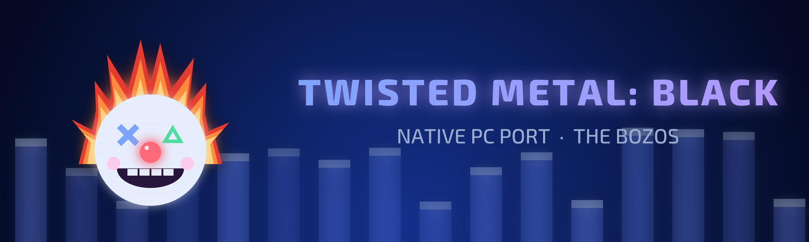

<div align="center">



# TMB_Recomp

**Twisted Metal: Black (USA, SCUS-97101), recompiled to native PC code on [BozoEngine](https://github.com/TheBozos/BozoEngine).**

Windows · OpenGL 3.3 · keyboard, mouse and controllers · MIT

</div>

> No game files are included. You must supply your own USA disc image. The European release is unsupported.
> The executable `SCUS_971.01` must have SHA-1 `3ff17f4897552e355d0bb8c3abfa5125fe3ff2ef`.

## Playing on Windows

1. Download `TMB_Recomp-<version>-bozo.zip` and its `.sha256` from [Releases](https://github.com/TheBozos/TMB_Recomp/releases).
   Check the download with `Get-FileHash .\TMB_Recomp-<version>-bozo.zip` in PowerShell.
2. Extract it into a writable folder, with about 10 GB free, outside `Program Files`.
3. Open **TMB Launcher.exe**, select your USA `.iso` or `.bin`/`.cue`, then **Prepare the game**.
   The included compiler builds the game locally. Preparing can be stopped and resumed; it needs no network.
4. Click **Play**. **F2** opens Controls, Video and Cheats; **F3** toggles the FPS counter;
   **F11** or **Alt+Enter** switches fullscreen. Controls are rebindable for up to four players.

The computer needs Windows 10/11, an **AVX2 and FMA capable CPU**, and OpenGL 3.3.
The target game speed is 60 updates per second. Higher presentation rates interpolate between game updates.
Heat haze around fire and explosions is enabled by default, matching the original game's effect.
Set `BOZO_HEAT_HAZE=0` before launching to disable it for comparison with the older PC build.

The folder contains `TMB Launcher.exe`, `source/`, `kit/`, `README.txt`, `CHANGELOG.md` and `LICENSES/`.
Keep them together. No game executable, disc content or generated game code is distributed.

Saves, controls and video settings live in `%APPDATA%\TMB_Recomp`; existing native memory-card files remain usable.
For isolated tests, set `PS2X_USER_DIR` to a scratch directory. The two builds share the user folder by default;
give each its own scratch folder when comparing them.

The launcher checks for newer releases unless disabled in Settings. Update checks the ZIP's SHA-256, installs
the new source and tools, and offers a rebuild. Saves remain in the user folder. Manual updates work by extracting
the new ZIP over the existing installation. Delete the installation folder to uninstall; delete the user folder
separately if you also want to remove saves and settings.

The previous PS2Recomp-based build remains available at [v0.3.2](https://github.com/TheBozos/TMB_Recomp/releases/tag/v0.3.2)
for comparison. This source tree builds only on BozoEngine: PS2Recomp is no longer a submodule or a build dependency.

## How it works

```text
Your USA disc
    │
    ├─ SCUS_971.01 ── bozo-recomp ── generated C++ ─┐
    └─ textures/models ── native asset packs ────────┤
                                                   ▼
                         TMB's game-specific native code + BozoEngine
                         OpenGL renderer · native sound driver/mixer
                         SDL3 window/input/audio · FFmpeg movies
```

The game's R5900 functions become C++ and run on the host CPU. BozoEngine supplies the native scheduler and library
services; TMB's hooks draw its meshes, particles, HUD and menus directly. The native 989SND implementation plays its
sound banks through the mixer. Movies are decoded with FFmpeg. There is no PS2Recomp runtime, IOP interpreter,
SPU2 emulator, GS renderer, VIF/GIF decoder or VU interpreter in the player build.

BozoEngine is The Bozos' MIT recompiler and runtime. Its clean-room specifications and migration validation are in
[`BozoEngine/docs`](BozoEngine/docs). TMB's own code is MIT too. Third-party libraries keep their own licences;
release ZIPs include the licences and corresponding source packages required by the bundled toolchain and FFmpeg.

## Building from source

Windows is the validated target. The sources are portable, but this migration has not been validated on Linux.
On Windows, use MSYS2 UCRT64 with GCC, CMake, Ninja and Python, or the pinned build kit.

```sh
git clone --recurse-submodules https://github.com/TheBozos/TMB_Recomp.git
cd TMB_Recomp
python tools/tmb_build.py --disc "D:/Discs/Twisted Metal - Black (USA).iso" \
    --out D:/TMB-build --kit D:/tmb_kit_bozo/kit
```

With an installed toolchain instead of a kit, use `--no-kit`. SDL3 and ImGui sources are fetched at pinned hashes;
FFmpeg's `libavcodec` and `libavutil` must be available. Use `--engine <path>` to develop against another BozoEngine tree.

The build steps are `verify`, `extract`, `configure`, `tools`, `recompile`, `packs`, `compile`, `stage`.
`--stop-after <step>` stops after a step; `--redo <step>` repeats it and the following steps.
The staged game is `<out>/TMB/tmb.exe`, with the ELF, native packs and `disc.iso` beside it. A same-drive ISO is
hard-linked; another drive or a raw BIN/CUE is copied/converted. The original image is never modified.

The shell shortcuts use the same pipeline:

```sh
export TMB_DISC="D:/Discs/Twisted Metal - Black (USA).iso"
export TMB_KIT="D:/tmb_kit_bozo/kit"
bash scripts/build_runtime.sh
bash scripts/run_native.sh
```

For a development build with an already extracted ELF:

```sh
export PATH=/c/msys64/ucrt64/bin:$PATH
cmake -S . -B build/bozo -G Ninja \
  -DTMB_ELF="D:/TMB-build/disc/SCUS_971.01" \
  -DTMB_ISO="D:/Discs/Twisted Metal - Black (USA).iso" \
  -DBOZO_FFMPEG_ROOT=D:/tmb_kit_bozo/kit/ffmpeg
cmake --build build/bozo -j 8
build/bozo/tmb.exe --iso "D:/Discs/Twisted Metal - Black (USA).iso"
```

`BOZO_ENGINE_DIR` overrides the submodule. `TMB_WINDOW=OFF` builds headless tools only.
`BOZO_BUILD_TOOLS=OFF` removes the zlib-dependent recording/checking tools from a player build.

## Validation and diagnostics

[`docs/HANDOFF.md`](docs/HANDOFF.md) records current evidence and remaining acceptance gates.
The checker compares native calls, RAM, scheduling and draw lists against recorded runs; headless mode runs without a log.
Reference recordings, captures, generated code and game data are local-only and never included in releases.

| Switch | Purpose |
|---|---|
| `PS2X_USER_DIR=<scratch>` | Isolate cards, settings and logs |
| `PS2X_FRAME_STATS=1` | Measure game-thread work independently of the frame cap |
| `TMB_TRACE_CLOCK=1 BOZO_TIMING_LOG=1` | Record menu timers, EE/PC clock ratio and movie picture cadence |
| `python tools/check_timing.py <log>` | Fail on sustained menu/movie speed errors or missing observations |
| `--audio-stats`, `--wav <file>` | Audio queue/underruns and output recording |
| `--pad-script [n=]<file>` | Frame-keyed scripted input for player n (1–4) |
| `--capture-dir <dir> --capture-frames n,n` | Capture selected game frames |
| `--quit-after <frames>` | End an unattended windowed run |
| `PS2X_FRAME_RATE=game\|monitor\|<n>` | Presentation rate; the game updates remain at their own rate |
| `BOZO_HEAT_HAZE=0` | Disable heat haze for comparisons with v0.3.2 |

In a UCRT64 shell, BozoEngine's instruction, runtime, library and mixer tests run with:

```sh
cmake -S BozoEngine -B build/engine-tests -G Ninja
cmake --build build/engine-tests -j 8
ctest --test-dir build/engine-tests --output-on-failure
```

## Releases

`tools/make_build_kit.py` assembles the pinned compiler, Python, FFmpeg, SDL3 and ImGui sources.
`tools/make_release.py` archives **committed files**, builds the launcher, audits the package and writes hashes:

```sh
python tools/make_release.py --version <version> --kit D:/tmb_kit_bozo/kit \
  --out D:/TMB-release --with-sources
python tools/make_release.py --verify-zip D:/TMB-release/TMB_Recomp-<version>-bozo.zip
```

The player ZIP is `TMB_Recomp-<version>-bozo.zip`, rooted at `TMB_Recomp_Bozo/`.
`TMB_Recomp-<version>-bozo-sources.zip` contains the toolchain/FFmpeg corresponding sources; the player ZIP already
contains TMB and BozoEngine source. The migration ZIP `TMB_Recomp-<version>.zip` carries the same BozoEngine payload
under `TMB_Recomp/` so the previous launcher can update in place. All ZIPs have `.sha256` files. The workflow builds from a version tag and creates
a draft; a manual workflow without a tag produces test artifacts. Follow
[`docs/RELEASE_CHECKLIST.md`](docs/RELEASE_CHECKLIST.md) before publication. No release is published on an ordinary push.

## Credits

**The Bozos**: boubou666 and Arzaroth. Our projects: [RecompWatcher](https://thebozos.github.io/RecompWatcher/).
The earlier port was built on [PS2Recomp](https://github.com/ran-j/PS2Recomp) by ran-j and contributors;
it remains credited in the project's history. BozoEngine replaces that dependency.

*Twisted Metal: Black* © Sony Interactive Entertainment, developed by Incognito Entertainment.
This is an unofficial fan project, not affiliated with or endorsed by them.
